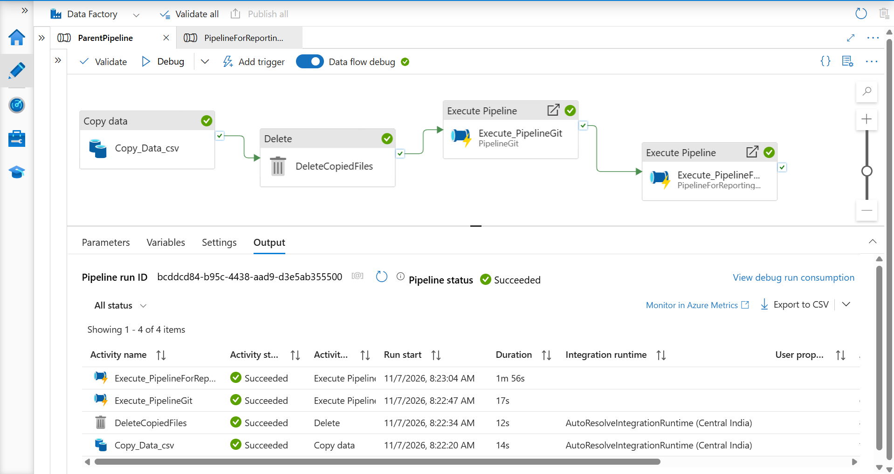
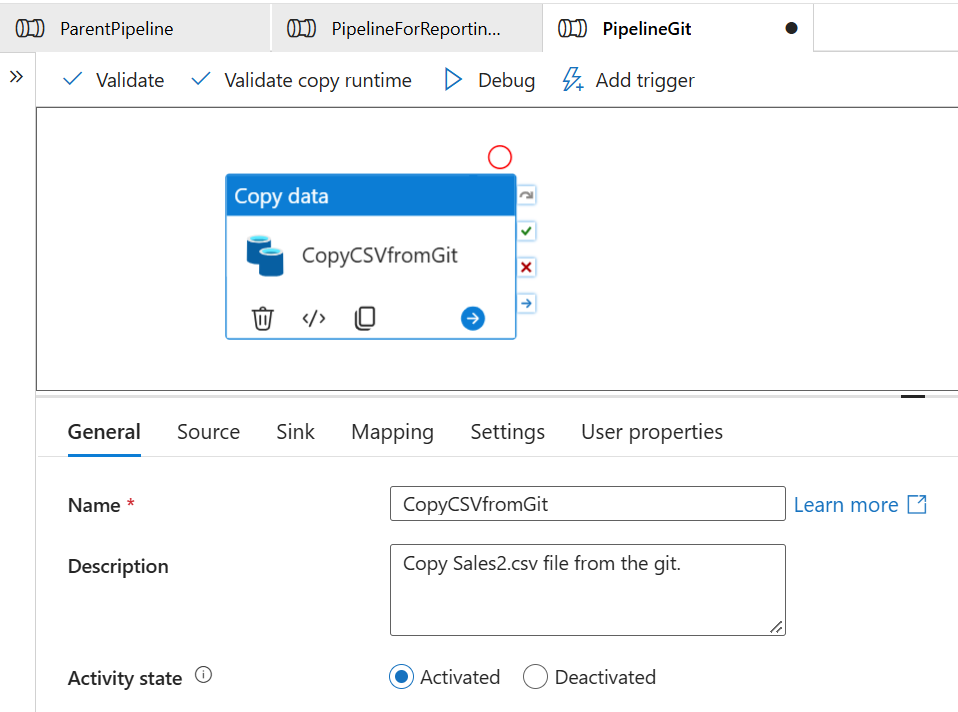
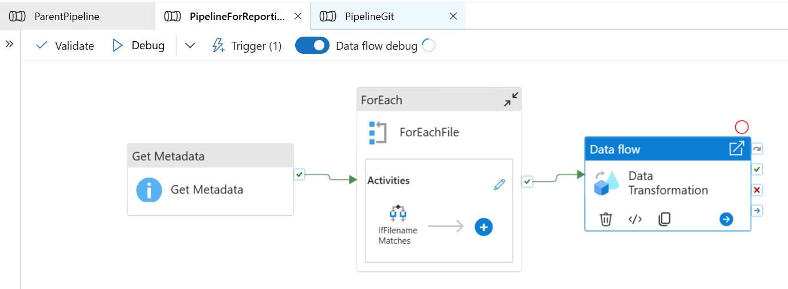
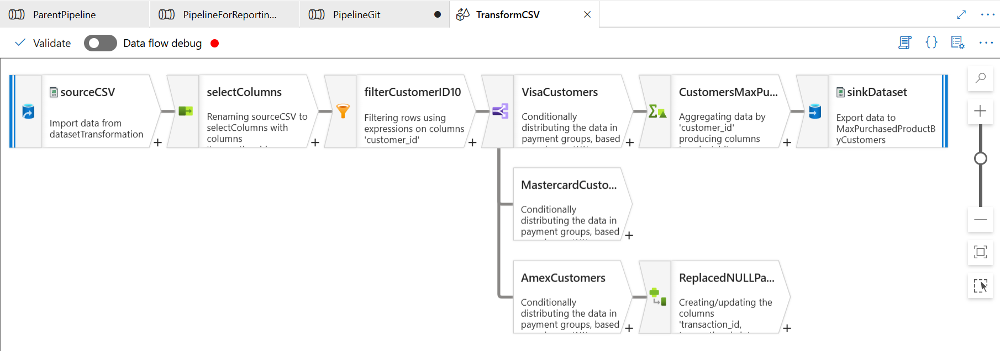

# ADF Parent–Child Pipelines with Execute Pipeline

An Azure Data Factory (ADF) project that shows how to chain pipelines using the **Execute Pipeline** activity. One **parent pipeline** moves a file between containers, then runs two **child pipelines** in order: one loads another file from GitHub, and the other transforms it with a **Mapping Data Flow**.



## Why Execute Pipeline?

Instead of building one giant pipeline, each job lives in its own small pipeline. The parent just calls them in order. This keeps pipelines easier to read, test, and reuse.

## What it does

The parent pipeline (`ParentPipeline`) runs four steps. Each step starts only after the previous one succeeds.

```
Copy_Data_csv  →  DeleteCopiedFiles  →  Execute_PipelineGit  →  Execute_PipelineForReporting
```

| Step | What it does |
|---|---|
| `Copy_Data_csv` | Copies `Data.csv` from the **source** container to the **destination** container |
| `DeleteCopiedFiles` | Deletes `Data.csv` from the **source** container, but only after the copy succeeds |
| `Execute_PipelineGit` | Runs the child pipeline `PipelineGit`, which copies `Sales2.csv` from a GitHub repo to the **destination** container |
| `Execute_PipelineForReporting` | Runs the child pipeline `PipelineForReportingContainer`, which finds `Sales2.csv` in the destination container and runs a data transformation on it |

## Storage containers

| Container | Purpose |
|---|---|
| `source` | Holds the original `Data.csv` (removed after it is copied) |
| `destination` | Receives `Data.csv` and `Sales2.csv` |
| `reporting` | Holds the transformed output |

## The child pipelines

### `PipelineGit`

A single **Copy data** activity (`CopyCSVfromGit`) that copies `Sales2.csv` from GitHub to the destination container.

- Source file: [Sales2.csv](https://raw.githubusercontent.com/arwak-codes/ADF-Storage-Event-Driven-File-Ingestion/refs/heads/main/Sales2.csv)



### `PipelineForReportingContainer`

```
Get Metadata  →  ForEach (ForEachFile)  →  Data flow
                    └─ If Condition: IfFilenameMatches
```

1. **Get Metadata** lists the files in the destination container.
2. **ForEach** loops through the files, and an **If Condition** checks whether the file name is exactly `Sales2.csv`.
3. **Data flow** (`TransformCSV`) runs the transformation.



### Data flow: `TransformCSV`

```
sourceCSV → selectColumns → filterCustomerID10 → split by payment type → aggregate → sink
```

| Transformation | What it does |
|---|---|
| `sourceCSV` | Reads the CSV file |
| `selectColumns` | Selects and renames columns |
| `filterCustomerID10` | Filters rows using an expression on `customer_id` |
| Conditional split | Splits rows into `VisaCustomers`, `MastercardCustomers`, and `AmexCustomers` based on payment type |
| `CustomersMaxPurchase` | Aggregates by `customer_id` to get each customer's maximum purchase (Visa branch) |
| `ReplacedNULL...` | Derived column that replaces NULL values (Amex branch) |
| `sinkDataset` | Writes the result to the `MaxPurchasedProductByCustomers` dataset |



## Azure services used

- Azure Data Factory (pipelines, Execute Pipeline, Mapping Data Flows)
- Azure Data Lake Storage Gen2

## Concepts practiced

- Parent and child pipelines with **Execute Pipeline**
- Chaining activities on success (copy first, delete only after a successful copy)
- Copying from an HTTP source (GitHub raw file) into Azure Data Lake Storage Gen2
- Get Metadata, ForEach, and If Condition
- Mapping Data Flow: select, filter, conditional split, aggregate, derived column, sink

## How to recreate it

1. Create three containers: `source`, `destination`, `reporting`. Upload `Data.csv` to `source`.
2. Create linked services and datasets for Azure Data Lake Storage Gen2 and for the GitHub raw file (HTTP).
3. Build `PipelineGit`: one Copy data activity from the GitHub raw URL to `destination`.
4. Build the data flow `TransformCSV` and the pipeline `PipelineForReportingContainer` (Get Metadata → ForEach with If Condition → Data flow).
5. Build `ParentPipeline`: Copy data → Delete → Execute Pipeline (`PipelineGit`) → Execute Pipeline (`PipelineForReportingContainer`). Link each activity to the next with the green **On success** arrow.
6. Click **Publish all**, then **Debug** the parent pipeline and check the **Output** tab.

> **Re-running:** `DeleteCopiedFiles` removes `Data.csv` from `source`, so upload it again before running the pipeline a second time. Otherwise the first Copy data step has nothing to copy.

> **Note:** Data flows run on a Spark cluster, so the reporting step takes noticeably longer than the copy steps. In my run it took about 1.5 minutes.

## Project files

```
pipeline/
├── ParentPipeline.json
├── PipelineGit.json
├── PipelineForReportingContainer.json
└── TransformCSV.json   (data flow)
images/
```

Pipeline and data flow JSON were exported from ADF Studio using the **{ }** code view.
